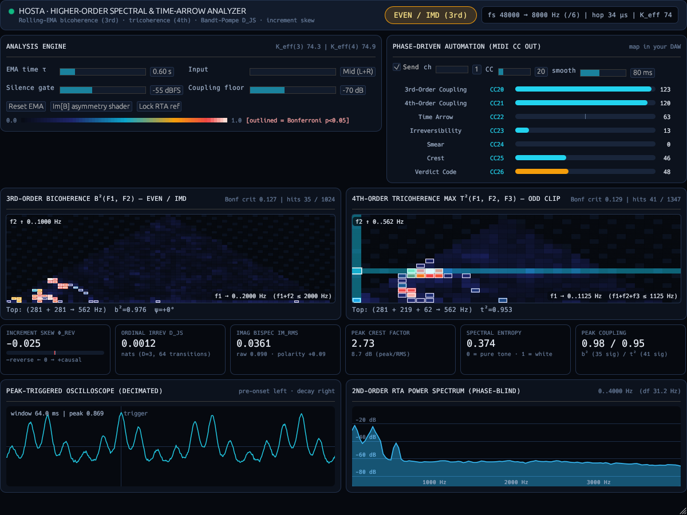
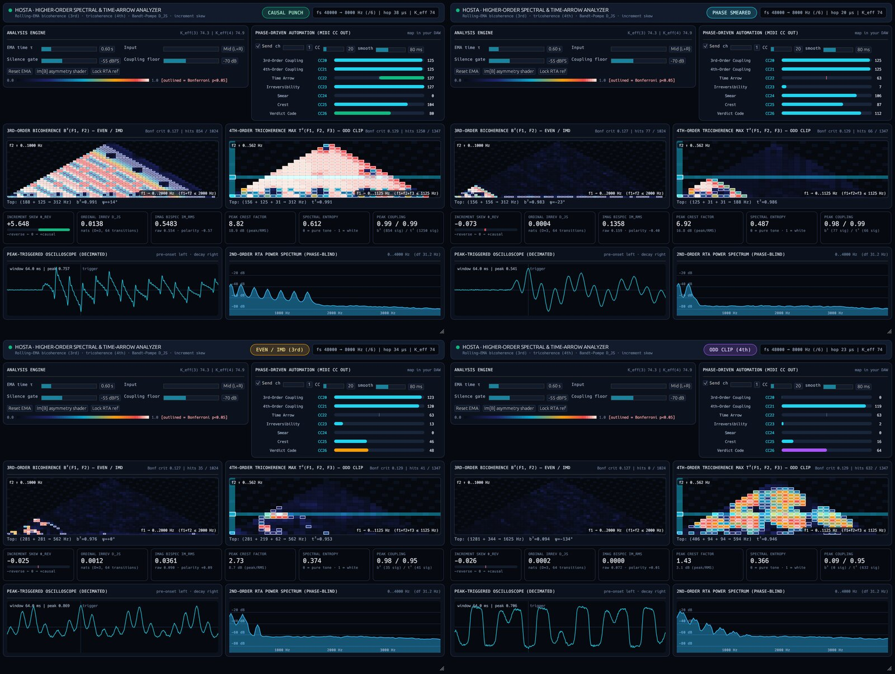

# HOSTA: Higher-Order Spectral & Time-Arrow Analyzer

A VST3 / CLAP plugin that shows the two things an EQ or spectrum analyzer is mathematically blind to:

1. **Hidden phase coupling.** A magnitude spectrum only says *how loud* each frequency is.
   Bicoherence (3rd order) and tricoherence (4th order) test whether frequencies are
   *phase-locked to each other*, which is what a nonlinearity does:
   * `f1 + f2 → f3` coupling: asymmetric / even distortion, sub-to-mid **intermodulation mud**
   * `f1 + f2 + f3 → f4` coupling: symmetric / odd **hard clipping**
2. **The time direction of transients.** A tight hit, a reversed hit and a phase-smeared
   (linear-phase pre-ringing, crossover, all-pass) hit can have *identical* spectra. HOSTA
   measures forward-vs-backward asymmetry directly: lag-1 increment skewness and the
   Jensen-Shannon divergence between ordinal patterns and their time reversal.

Both feed **MIDI CC outputs**, so you can drive any parameter in your DAW from distortion
coupling or transient direction instead of from level.

Audio passes through **bit-exact, zero latency**. HOSTA never changes your sound.



<sub>Clockwise from top left: dry kick → CAUSAL PUNCH, linear-phase kick → PHASE SMEARED,
symmetric clipper → ODD CLIP, tube + sub IMD → EVEN / IMD.</sub>


## What the verdicts mean

| Verdict | Condition (corrected rules, see below) |
|---|---|
| **CAUSAL PUNCH** | Transient material (crest ≥ 3) with forward skew φ_rev ≥ +0.5 **and** ordinal irreversibility D_JS ≥ 0.0025 |
| **REVERSED ARROW** | Same, with φ_rev ≤ −0.5 |
| **PHASE SMEARED** | Strongly transient (crest ≥ 5, ≈ 14 dB) but **no** confirmed direction: the hit lost its arrow |
| **EVEN / IMD (3rd)** | Sustained material with ≥ 3 Bonferroni-significant triads and peak b² ≥ 0.6 |
| **ODD CLIP (4th)** | Sustained material with significant quartets, peak t² ≥ 0.6, and no 3rd-order coupling |
| **CLEAN / UNCOUPLED** | None of the above |

Hover either heatmap to read the exact triad/quartet (frequencies, coherence, biphase,
significance). The **Im[B] asymmetry shader** re-weights the maps by sin²ψ to show
time-asymmetric (quadrature) coupling.

## Phase-driven automation (MIDI CC out)

Default channel 1, CC 20–26 (CCs 20–31 are undefined in the MIDI spec). The channel, first
CC and output smoothing are all parameters.

| CC | Output | 0 … 127 |
|---|---|---|
| 20 | 3rd-order coupling | strongest b² above the significance threshold |
| 21 | 4th-order coupling | strongest t² above the significance threshold |
| 22 | Time arrow | 64 = no direction, → 127 forward, → 0 reversed (needs D_JS confirmation, so noise stays at 64) |
| 23 | Irreversibility | D_JS, full scale 0.01 nats |
| 24 | Smear | transient-ness × lack of direction (pre-ring / all-pass smear) |
| 25 | Crest | 0–24 dB |
| 26 | Verdict code | value = code × 16: 0 idle, 16 warm-up, 32 clean, 48 even/IMD, 64 odd clip, 80 causal, 96 reversed, 112 smeared |

Your host has to accept MIDI output from an *effect* plugin (REAPER and Bitwig do). Ableton
Live does not route MIDI out of audio effects, so there you'd need a host-side workaround.

## Honest limits (read this before trusting a verdict)

* **A harmonic note is phase-coupled by nature.** A clean sawtooth's harmonics are locked to its
  fundamental exactly the way a distorted sine's are: they are literally the same waveform.
  So a rich, clean synth will read EVEN / IMD. Coupling is unambiguous between **independent
  sources** (sub × mid IMD, which a clean mix never has). The most reliable workflow is
  **differential**: put HOSTA before and after a processor and watch the coupling *change*.
* **Analysis band is 0 – ~3.4 kHz** (an 8 kHz decimated copy, as in the prototype). 3rd order covers
  outputs up to 2 kHz; 4th order covers outputs up to 1.125 kHz, so it sees odd clipping of
  fundamentals up to ~375 Hz (their 3rd harmonic). That is the sub / low-mid / body region where mud
  and punch live; it is not a top-end analyzer.
* **Transient verdicts need transients.** A brickwalled master with crest < 3 shows no arrow. That is
  arguably the truth about it.
* Coupling statistics need time: τ = 0.6 s by default, about 1 s to settle.

## Changes from the browser prototype (`time.py`)

`time.py` is the original single-file WebGL prototype (it is HTML, despite the extension). The Rust
engine is a line-by-line port and **reproduces it to ~1e-15** in `legacy` mode
(`tools/parity.js` + `cargo run -p hosta-core --release --example parity`). Running the prototype's
own seven test scenes headlessly exposed these problems, now fixed by default:

| Problem in the prototype | Effect | Fix |
|---|---|---|
| `imRms ≥ 0.06` used as evidence, but its noise floor is ≈ √(1/2K) ≈ 0.1 | Clean mix and white noise → **PHASE SMEARED** | Bias-corrected Im_RMS; no longer used as evidence for a verdict |
| Reverse/causal accepted `imRms ≥ 0.05` instead of ordinal irreversibility | All-pass smeared kick → **REVERSED ARROW** | Direction requires skew **and** D_JS, and |φ| ≥ 0.5 |
| Per-frame mean subtraction before windowing injects the tones' phase into bins 0–1 | A single sine reads as phase-coupled to itself (t² ≈ 0.65) | 5 Hz DC blocker upstream instead |
| No energy floor: Hann leakage of a pure tone is phase-locked to it | Digital test tone → **ODD CLIP** | Per-bin coupling floor (default −70 dB re loudest bin) |
| Coupling threshold 0.28 sits inside the clean mix's null spread (p99 ≈ 0.5) | Clean mix flagged ODD/EVEN ~35% of the time | Threshold 0.6 (real coupling is 0.9+) → ~1% |
| Scope ring of 128 ms | Kick at 125 BPM mostly out of view | ~0.5 s ring |

Current results (`cargo test -p hosta-core --release`, at 44.1 / 48 / 96 kHz): all 7 scenes classified
correctly; pure tones at 55 Hz–2.5 kHz, tone + noise and white noise read CLEAN; a tanh-clipped sine
reads ODD and `x + x²` reads EVEN; the audio path never allocates.

## Build

Rust stable; on Linux also `libx11-xcb-dev libxcursor-dev libgl-dev libxcb-icccm4-dev libxcb-dri2-0-dev`.

```sh
cargo xtask bundle hosta --release        # → target/bundled/HOSTA.vst3, HOSTA.clap
cargo test -p hosta-core --release        # engine + classifier regression tests
cargo run -p clap-smoke --release -- target/bundled/HOSTA.clap   # load the real binary, check pass-through + CCs
cargo run -p hosta --release --features standalone -- --backend jack   # standalone app
```

Copy `HOSTA.vst3` / `HOSTA.clap` to your plugin folder (`~/.vst3`, `~/.clap` on Linux;
`/Library/Audio/Plug-Ins/{VST3,CLAP}` on macOS; `C:\Program Files\Common Files\{VST3,CLAP}` on Windows).
Built and tested on Linux so far; macOS / Windows go through the same `cargo xtask bundle` but have
not been built yet (macOS bundles also need code-signing).

## Layout

```
crates/hosta-core/   DSP engine (no dependencies): decimator, FFT, bi/tricoherence, time arrow,
                     classifier, control outputs, the 7 synthetic test scenes, tests
plugin/              nih-plug VST3/CLAP wrapper, MIDI CC out, egui editor
tools/clap-smoke/    minimal CLAP host used as an end-to-end test of the built binary
tools/parity.js      runs the original JS engine for bit-level comparison
time.py              the original browser prototype (HTML/WebGL)
```

Plugin code is GPL-3.0-or-later (nih-plug's VST3 bindings are GPLv3); `hosta-core` is MIT.
